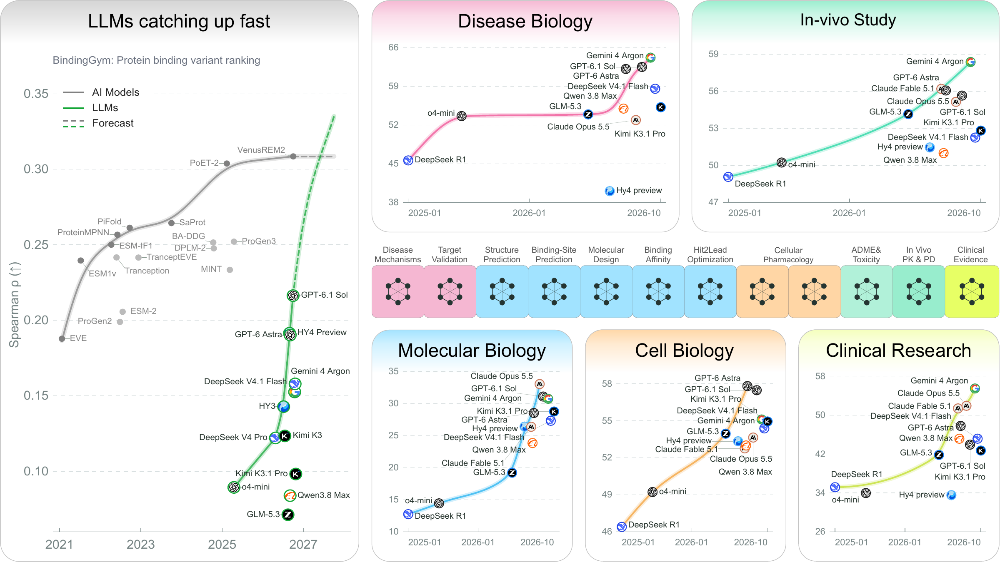
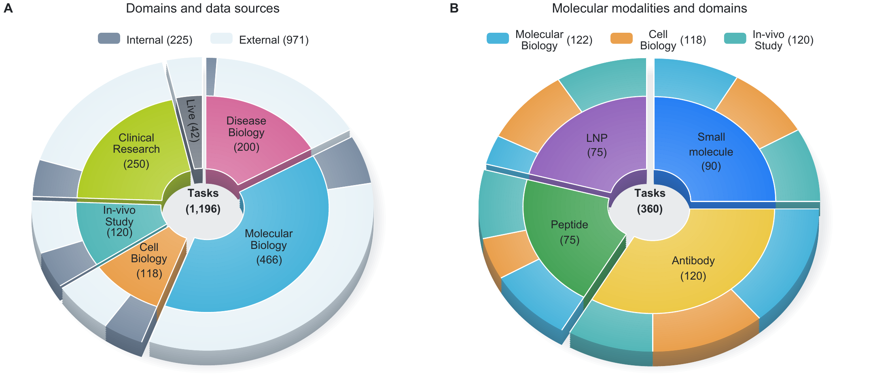

<div align="center">


<h3>Benchmarking Intrinsic LLM Capabilities<br>Across Drug Discovery and Development</h3>

<p align="center">
  <sub>
    Lingang Laboratory AI · Shanghai AI Laboratory · Changping Laboratory<br>
    Guangzhou Laboratory · Shanghai Jiao Tong University<br>
    Shanghai Jiao Tong University School of Medicine · Fudan University<br>
    Zhongshan Hospital, Fudan University · The University of Hong Kong<br>
    Westlake University · Alibaba AI Data
  </sub>
</p>

<sub>An expert-designed benchmark grounded in biological evidence.</sub>

[](https://oribench.lglab.ac.cn/fdb) &nbsp; [](docs/FrontierDrugBench.pdf) &nbsp; [](https://huggingface.co/datasets/LG-FrontierAI/FrontierDrugBench) &nbsp; [](#citation)

**971** public tasks &nbsp;·&nbsp; **5** biological domains &nbsp;·&nbsp; **42** Live Benchmark tasks

<sub>The 42 Live tasks are included in the 971-task public release. · v1.0 · CC BY 4.0</sub>

</div>

**How far can a general-purpose language model go across drug discovery?**
FrontierDrugBench evaluates zero-shot scientific judgment across disease biology,
molecular biology, cell biology, in-vivo studies and clinical research.
Experimental scientists and pharmaceutical experts define the questions,
biological endpoints and scoring criteria. References are grounded in measured
functional data, resolved structures, curated clinical annotations or explicitly
identified computational proxies.



*From the technical report: model performance across drug discovery and development.
Dashed lines show illustrative forecasts; metrics and model coverage differ across
panels. This figure describes the report evaluation, not scores on the public subset.*

[Composition](#composition)  ·  [Getting started](#getting-started)  ·  [Repository structure](#repository-structure)  ·  [Grading](#grading)  ·  [Limitations](#limitations)  ·  [Citation](#citation)

## Composition

The full benchmark contains **1,154 tasks across five biological domains** and a
separately reported **42-task Live Benchmark**, for **1,196 tasks** in total.
This repository publishes the **971 externally sourced tasks** (81.2% of the
inventory).



*Full benchmark coverage. Left: biological domains and source provenance. Right:*  
*the 360-task experimental-property and design block by modality and domain.*  
*The two panels are not additive.*

By research domain (`category` in each task header):

| Domain | Public release | Full benchmark |
| --- | ---: | ---: |
| Molecular Biology | 400 | 466 |
| Clinical Research | 200 | 250 |
| Disease Biology | 187 | 200 |
| Cell Biology | 71 | 118 |
| In-vivo Study | 71 | 120 |
| **Five-domain subtotal** | **929** | **1,154** |
| Live Benchmark | 42 | 42 |
| **Total** | **971** | **1,196** |

> [!NOTE]
> **The public subset differs from the full-report evaluation.**
> The remaining 225 internally sourced tasks are not distributed, so scores
> computed here are not directly comparable with the report's 1,154-task results.
> Live Benchmark keeps its own label and is reported separately. It is a rolling
> forecasting set, not a sixth biological domain, and never enters the
> five-domain aggregate.

## Getting started

1. **Choose a task.** Browse the [task index](benchmark/metadata/tasks.csv) for its

   `bench_id`, domain and response format.
2. **Read the prompt.** Use the body after `# Prompt` in the task's

   `instruction.md`. Keep reference answers in `tests/` hidden from the evaluated
     model.
3. **Score the response.** Follow the task's `tests/score.py` contract and retain

   the shared `_packages/` directory. See the [benchmark guide](benchmark/README.md)
     for file layouts, output contracts and scoring dependencies.

This release includes task data, references and scorers. **No evaluation harness
is included.** A runner can send each task prompt and collect its reply.

Prompts are shipped already expanded: any data a task cites is inlined, so copying
the prompt body to a model sends the data rather than a path. `inputs/` holds the
same payload as separate files.

Keep input files unchanged, including formatting; some scorers verify file checksums.

## Repository structure

```text
FrontierDrugBench/
├── README.md
├── CITATION.cff
├── CONTRIBUTING.md
├── docs/
│   ├── FrontierDrugBench.pdf     Technical report
│   └── assets/                  README figures and visual assets
└── benchmark/
    ├── README.md                Task layout and scoring guide
    ├── metadata/
    │   └── tasks.csv            Public task index
    └── tasks/
        ├── _packages/           Shared scorers and assets
        └── <bench_id>/
            ├── instruction.md   Prompt and classification metadata
            ├── inputs/          Payloads, when present (137 tasks)
            └── tests/
                ├── score.py     Authoritative grader
                ├── answer.json  Reference answer and scoring rule
                ├── rubric.txt   Rendered rubric, when applicable
                ├── reference/   Structure/design reference payloads
                └── cases/       Multi-case reference answers
```

The [technical report](docs/FrontierDrugBench.pdf) was updated on 2026-11-25.
Figure provenance and export details are documented in
[the asset notes](docs/assets/README.md).
The report's full institutional affiliations are listed in
[the affiliation notes](docs/affiliations.md).

## Grading

Every task ships its authoritative grader. Most scorers are thin wrappers over
`benchmark/tasks/_packages/frontier_benchkit/`, loaded by path. If tasks are copied
elsewhere, preserve `_packages/` as a sibling of the task directories, including
its required assets, and retain each task's `tests/` and `inputs/` files. Copying
only a task directory does not preserve its shared scoring dependencies.

Aggregation is the **five-domain macro-average**: each domain's mean over the tasks
scored in it, then the mean of the five, so a domain with 400 tasks does not
outweigh one with 71. Within the five biological domains, recorded execution
failures, refusals, parsing failures and timeouts count as zero. Live Benchmark
uses the separate native metrics and fallback rules below and is never pooled in.

**Scoring types and task counts**

`tests/answer.json` holds the reference and, for 809 of the 971 tasks, names the
comparison under `scoring.type`. The other 162 implement the comparison directly
in their own `score.py`.

| `scoring.type`                      | Tasks | Comparison                                                           |
| ----------------------------------- | ----: | -------------------------------------------------------------------- |
| `structure_case`                    | 344   | predicted coordinates or sequences vs. a frozen structural reference |
| *(absent: task-local* `score.py`*)* | 162   | whatever the task's own scorer implements                            |
| `label_exact`                       | 100   | exact match of a normalised label                                    |
| `healthbench_rubric_judge`          | 100   | an LLM judge weighs the answer against a criteria list               |
| `option_letter`                     | 88    | one option letter                                                    |
| `ranking_concordant`                | 63    | concordant-pair ratio against the reference ordering                 |
| `mixed`                             | 36    | a weighted combination declared in the key                           |
| `relative_wis`                      | 32    | lower-is-better Relative WIS; scorer returns `1 - Relative WIS`      |
| `numeric_gaussian`                  | 20    | Gaussian log-score around the reference value                        |
| `binary_accuracy`                   | 10    | correct/incorrect call                                               |
| `top_k_overlap`                     | 8     | overlap between the predicted and reference top-k sets               |
| `option_set`                        | 8     | set equality of selected options                                     |

Ranking tasks are scored by the **concordant-pair ratio**: the fraction of
candidate pairs ordered as the reference orders them, so a random ordering scores
0.50 by construction.


**LLM judges and design-task dependencies**

- **117** `open_rubric` **tasks** are graded by an LLM judge against a frozen rubric.
The judge is an OpenAI-compatible endpoint configured through `LLM_BASE_URL`,
`LLM_API_KEY` and `LLM_MODEL` (plus optional `LLM_MAX_TOKENS`, `LLM_TIMEOUT`,
`LLM_TEMPERATURE`, `LLM_THINKING`, `LLM_REASONING_EFFORT`, retry knobs). These
are the interface names the reference harness exports; renaming them breaks
scoring.
- **20** `design` **tasks** are graded by predicting each submitted sequence or
molecule with a frozen protocol, which needs AlphaFold3 and a GPU.


**Live Benchmark: accuracy and Relative WIS**

Report **accuracy over ten binary questions** and **Relative WIS over 32 numerical
questions** separately. Relative WIS is lower-is-better and can exceed one.
The shipped scorer returns `score = 1 - Relative WIS`, which can be negative;
the native metric is available as `evaluate(...)["detail"]["relative_wis"]`.

Invalid numerical forecasts fall back to Relative WIS = 1 (`score = 0`) and
remain in the fixed 32-question denominator. Invalid binary outputs score zero.
Neither metric enters the five-domain macro-average.


## Intended use

Measuring the zero-shot scientific judgement of general-purpose models on
drug-discovery and development questions, and tracking progress against specialist
systems on matched subsets. Specialist comparisons cover matched subsets only:
the reference is the best evaluated pipeline on that subset, not an exhaustive
comparison with the state of the art.

**Not intended as a clinical decision tool.** The tasks are research instruments
and several are deliberately narrow: one assay, one endpoint, one structure.

## Limitations

- Several tasks share one source study, structure, trial or assay, so they are
not independent biological replicates and cannot be treated as a random sample
of endpoints.
- The 0–100 display spans heterogeneous metrics. The five-domain mean is a
descriptive composite of capability breadth, not calibrated accuracy on a common
error scale.
- Twenty `design` tasks cannot be re-scored without AlphaFold3 inference, so the
rest of the tree runs on CPU but those do not.
- Reference answers are distributed because the graders need them. The release
includes `tests/answer.json`, `tests/reference/` payloads and per-case answers;
evaluated models must not be given access to these files.

## Contributing

Corrections to a reference answer need the source that establishes the right
value, and any change to `inputs/` is treated as a breaking change. See the
[contribution guide](CONTRIBUTING.md).

`benchmark/metadata/tasks.csv` is the single index of the release: adding or
removing a task means updating the tree, the index and the counts above together.


## Citation

```bibtex
@misc{frontierdrugbench2026,
  title  = {FrontierDrugBench: Benchmarking Intrinsic LLM Capabilities
            Across Drug Discovery and Development},
  author = {{Lingang Laboratory AI} and
            {Shanghai AI Laboratory} and
            {Changping Laboratory} and
            {Guangzhou Laboratory} and
            {Shanghai Jiao Tong University} and
            {Shanghai Jiao Tong University School of Medicine} and
            {Fudan University} and
            {Zhongshan Hospital, Fudan University} and
            {The University of Hong Kong} and
            {Westlake University} and
            {Alibaba AI Data}},
  year   = {2026},
}
```

`CITATION.cff` retains the dataset authorship and release metadata and includes
the technical report as the preferred citation. Both report citations use the
cover-page institutions as parallel group authors; personal authors are not listed.
Full institutional names are recorded in [the affiliation notes](docs/affiliations.md).

## License

Task instructions, input data, verification scripts and rubrics are released under
[CC BY 4.0](LICENSE). Source documents referenced by individual tasks (patent
publications, journal articles) remain subject to their own terms.
